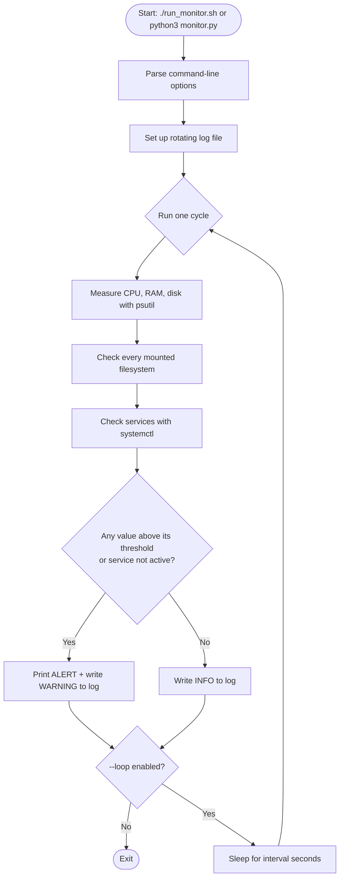

<div align="center">


# 🖥️ Linux Server Monitoring & Alert System

**A lightweight Python + Bash tool that watches your server's CPU, RAM, disk and services,
raises alerts the moment a threshold is crossed, and keeps a permanent log for later investigation.**


[Overview](#-overview) •
[How it works](#-how-it-works) •
[Quick start](#-quick-start) •
[Usage](#-usage) •
[Code walkthrough](#-code-walkthrough) •
[Troubleshooting](#-troubleshooting) •
[Interview Q&A](#-interview-qa)

</div>

---

## 📖 Table of contents

1. [Overview](#-overview)
2. [Features](#-features)
3. [How it works](#-how-it-works)
4. [Project structure](#-project-structure)
5. [Quick start](#-quick-start)
6. [Usage](#-usage)
7. [Configuration reference](#-configuration-reference)
8. [Example output](#-example-output)
9. [Code walkthrough](#-code-walkthrough)
10. [The Bash launcher](#-the-bash-launcher)
11. [Testing the alerts](#-testing-the-alerts)
12. [Running continuously](#-running-continuously)
13. [Troubleshooting](#-troubleshooting)
14. [Limitations & roadmap](#-limitations--roadmap)
15. [Interview Q&A](#-interview-qa)
16. [Concepts glossary](#-concepts-glossary)

---

## 🎯 Overview

### The problem
A server is a computer that provides services (a website, a database, remote login) to other computers.
Those services depend on four things staying healthy:

| Resource | What it does | What happens when it runs out |
| --- | --- | --- |
| **CPU** | Executes instructions | Applications slow down or stop responding |
| **RAM** | Holds data for running programs | Processes fail, or Linux's *OOM killer* terminates one |
| **Disk** | Stores OS, apps, logs, databases | Programs can't write files, logs or database data |
| **Services** | Background programs (SSH, Nginx…) | The feature they provide disappears (site down, no remote access) |

A system administrator cannot stare at a terminal 24/7 for every server. **Automated monitoring** does the
watching and speaks up only when something needs attention.

### The solution
This project automatically:

1. 📊 **Measures** CPU, RAM, disk usage and service status
2. ⚖️ **Compares** each measurement with a configurable threshold
3. 🚨 **Alerts** in the terminal when a threshold is exceeded
4. 📝 **Records** every measurement and warning, with timestamps, in `monitor.log`

> **Scope note:** this version prints alerts and writes logs. It does **not** fix problems automatically,
> send emails, or report to an external monitoring service. See [Limitations & roadmap](#-limitations--roadmap).

---

## ✨ Features

- ✅ CPU, RAM and disk monitoring with **configurable thresholds** (command-line flags)
- ✅ Checks **every mounted filesystem**, not just `/`
- ✅ **Service checks** through `systemctl` (SSH by default; any number of services with `-s`)
- ✅ Graceful handling of a **missing `systemctl`**, command **timeouts**, and error output
- ✅ **Rotating log file** (1 MB × 3 backups) so logs can never fill the disk by themselves
- ✅ **Run-once or continuous** mode (`--loop`) with a custom interval
- ✅ The loop **survives unexpected errors** and logs them instead of crashing
- ✅ Clean **Ctrl + C** shutdown that is also logged
- ✅ **Bash launcher** that works from any directory and passes options through

---

## 🧠 How it works



<p align="center"></p>

**Worked example.** Disk usage reaches 91 % and the threshold is 85 %:

1. `shutil.disk_usage("/")` reports used and total bytes.
2. Python calculates `used / total × 100 = 91 %`.
3. `91 > 85` is true, so an `ALERT:` line is printed.
4. A `WARNING` line with a timestamp is written to `monitor.log`.
5. An engineer later investigates with `df -h` and `du -sh /var/log`.

---

## 📁 Project structure

```text
linux-monitor/
├── monitor.py        # The monitoring program (all the logic lives here)
├── run_monitor.sh    # Bash launcher: finds its own folder and starts monitor.py
├── README.md         # This documentation
├── .gitignore        # Keeps log files and Python cache out of Git
├── assets/           # Banner and diagrams used by this README
├── screenshots/      # Your proof-of-work images (see Screenshots section)
└── monitor.log       # Created automatically on first run (not committed)
```

---

## 🚀 Quick start

### 1. Get Ubuntu
Use any Ubuntu machine or VM. On Windows you can use WSL:

```powershell
wsl --install -d Ubuntu
```

> ⚠️ WSL and containers often **don't run systemd**, so service checks will report a problem there.
> The CPU, RAM and disk checks still work. For the full project, use a real Ubuntu VM or server.

### 2. Install dependencies
```bash
sudo apt update                                # refresh the package list
sudo apt install python3 python3-psutil -y     # Python + the psutil library
```

Verify:
```bash
python3 --version
python3 -c "import psutil; print(psutil.__version__)"
```

### 3. Get the project
```bash
git clone https://github.com/YOUR-USERNAME/linux-monitor.git
cd linux-monitor
chmod +x run_monitor.sh
```

### 4. Run it
```bash
./run_monitor.sh
cat monitor.log
```

---

## 🕹️ Usage

```bash
python3 monitor.py                        # check once, then exit
python3 monitor.py --loop                 # check every 60 s until Ctrl+C
python3 monitor.py --loop -i 30           # check every 30 s
python3 monitor.py -s ssh -s nginx        # check several services
python3 monitor.py --cpu-limit 90         # change a threshold
python3 monitor.py --log-file /tmp/m.log  # choose the log location
./run_monitor.sh --loop -i 30             # same options via the Bash launcher
tail -f monitor.log                       # watch the log live (Ctrl+C to stop watching)
```

---

## ⚙️ Configuration reference

| Option | Default | Meaning |
| --- | --- | --- |
| `--cpu-limit N` | `80` | Alert when CPU usage is **greater than** N % |
| `--ram-limit N` | `80` | Alert when RAM usage is greater than N % |
| `--disk-limit N` | `85` | Alert when any mounted filesystem is greater than N % full |
| `-s`, `--service NAME` | `ssh` | Service to check. Repeat the flag for several services |
| `--loop` | off | Keep running instead of checking once |
| `-i`, `--interval SECONDS` | `60` | Pause between checks in loop mode |
| `--log-file PATH` | `monitor.log` | Where to write the log |

<p align="center"></p>

> The thresholds are **examples, not universal best practice**. Real thresholds depend on the workload.
> A CPU spike to 85 % for a moment is usually normal; *sustained* high CPU deserves investigation.

---

## 🧾 Example output

> The values below are **illustrative**; your numbers will differ.

**Terminal, healthy server**
```text
Linux Server Monitoring Started
CPU Usage: 14.2%
RAM Usage: 48.7%
Disk Usage: 39.1%
ssh service: active
```

**Terminal, with alerts** (e.g. thresholds lowered for testing)
```text
Linux Server Monitoring Started
CPU Usage: 14.2%
RAM Usage: 48.7%
Disk Usage: 39.1%
ALERT: High CPU usage detected (14.2% > 0.0%)
ALERT: High RAM usage detected (48.7% > 0.0%)
ssh service: active
```

**`monitor.log`**
```text
2026-10-27 09:15:00,120 - INFO - CPU=14.2%, RAM=48.7%, DISK=39.1%
2026-10-27 09:15:00,121 - WARNING - High CPU usage detected (14.2% > 0.0%)
2026-10-27 09:15:00,121 - WARNING - High RAM usage detected (48.7% > 0.0%)
2026-10-27 09:15:00,140 - INFO - Service ssh is active
```

### 📸 Screenshots
Add your own screenshots to the `screenshots/` folder:

| Normal run | Forced alert (`--cpu-limit 0`) |
| --- | --- |
|  |  |

---

## 🔬 Code walkthrough

### Libraries used

| Module | Purpose |
| --- | --- |
| `argparse` | Reads command-line options such as `--loop` |
| `logging` + `RotatingFileHandler` | Writes timestamped, size-limited log files |
| `shutil` | Reports disk usage (`disk_usage`) |
| `subprocess` | Runs the external command `systemctl` |
| `time` | Provides `sleep()` for loop mode |
| `sys` | Returns an exit code to the shell |
| `psutil` | Reads CPU, RAM and mount-point information |

### 1. Logging: `setup_logging()`
```python
handler = RotatingFileHandler(log_file, maxBytes=1_000_000, backupCount=3)
handler.setFormatter(logging.Formatter("%(asctime)s - %(levelname)s - %(message)s"))
```
- **Why log?** If a problem happens at 2 AM, an engineer can read the log in the morning instead of
  needing to have watched the terminal at that exact moment.
- **Rotation:** when `monitor.log` reaches about 1 MB it becomes `monitor.log.1`, and so on, keeping 3 old files.
  A monitoring tool that fills the disk with its own logs would defeat its own purpose.
- **Format fields:** `%(asctime)s` is the timestamp, `%(levelname)s` is the severity (`INFO`, `WARNING`, `ERROR`),
  and `%(message)s` is your text.

### 2. Alerts: `alert()`
```python
def alert(message):
    print(f"ALERT: {message}")
    logging.warning(message)
```
One small function means every alert is printed **and** logged the same way. `print` is for the person
watching now; `logging` is for the person investigating later.

### 3. System metrics: `check_system()`
```python
cpu  = psutil.cpu_percent(interval=1)
ram  = psutil.virtual_memory().percent
usage = shutil.disk_usage("/")
disk = usage.used / usage.total * 100
```
- `cpu_percent(interval=1)` measures how busy the CPU was **over one second**. It says *how busy*, not *which
  process* caused it. To find the culprit: `top` or `ps aux --sort=-%cpu | head`.
- `virtual_memory().percent` is the percentage of RAM in use. High RAM alone doesn't prove a problem because
  Linux uses spare memory for caching. Check manually with `free -h`.
- Disk usage = `used ÷ total × 100`. The disk information is fetched **once** and stored in `usage` rather than
  asking the OS twice. Check manually with `df -h`.

Then each value is compared with its threshold:
```python
if cpu > cpu_limit:
    alert(f"High CPU usage detected ({cpu}% > {cpu_limit}%)")
```
`>` means *strictly greater than*, so a reading of exactly 80 % does not alert. The three checks are
**independent**; a single run can raise three alerts.

### 4. Every filesystem: `check_disks()`
```python
for part in psutil.disk_partitions(all=False):
    u = psutil.disk_usage(part.mountpoint)
```
A server often has several disks or partitions (`/`, `/var`, `/home`, a data volume…). Checking only `/` would
miss a full data disk. `try/except` skips mounts the program isn't permitted to read.

### 5. Services: `check_service()`
```python
result = subprocess.run(["systemctl", "is-active", service],
                        capture_output=True, text=True, timeout=10)
```
- The command is passed as a **list**, not one string. This avoids shell-injection problems and is the
  recommended way to call external programs.
- `capture_output=True, text=True` captures the output as a string; `.strip()` removes the trailing newline.
- `timeout=10` stops a hung command from freezing the monitor.
- Three failure cases are handled separately:

| Situation | What the program does |
| --- | --- |
| `systemctl` doesn't exist (`FileNotFoundError`) | Alerts that systemd is unavailable |
| Command takes too long (`TimeoutExpired`) | Alerts about the timeout |
| Status isn't `active` (`inactive`, `failed`, `unknown`…) | Alerts with the status and any error text |

### 6. The main loop: `main()`
```python
while True:
    try:
        run_once(args)
    except Exception as exc:
        logging.error(f"Monitoring cycle failed: {exc}")
    if not args.loop:
        break
    time.sleep(args.interval)
```
- Without `--loop`, the first pass ends with `break`, so it runs **once**.
- With `--loop`, it sleeps and repeats forever.
- The inner `try/except` means **one bad cycle doesn't kill the monitor**; the error is logged and monitoring continues.
- `KeyboardInterrupt` (Ctrl + C) is caught outside the loop for a clean, logged exit.
- Note: the real cycle time is `interval` + about 1 second, because `cpu_percent(interval=1)` itself waits one second.

### 7. The entry point
```python
if __name__ == "__main__":
    sys.exit(main())
```
When a file is run directly, Python sets `__name__ == "__main__"`, so `main()` runs. If another program
*imports* `monitor.py`, this block is skipped, which keeps the functions reusable.

---

## 🐚 The Bash launcher

```bash
#!/bin/bash
cd "$(dirname "$(readlink -f "$0")")" || exit 1
echo "Starting Linux system monitor..."
python3 monitor.py "$@"
```

| Part | Meaning |
| --- | --- |
| `#!/bin/bash` | Tells Linux to run the script with Bash |
| `$(dirname "$(readlink -f "$0")")` | Finds the folder the script itself lives in, so it works from anywhere |
| `\|\| exit 1` | Stops immediately if changing directory fails |
| `"$@"` | Passes all your options to Python (`./run_monitor.sh --loop -i 30`) |
| exit status check | Reports a non-zero exit status from Python |

`chmod +x run_monitor.sh` is needed once to give the file **execute** permission.

**Python vs Bash here:** Python implements the monitoring logic; Bash handles launching and operating it.
They complement each other.

---

## 🧪 Testing the alerts

A monitor that has never raised an alert is unproven. Test the *abnormal* path safely by setting
thresholds to zero instead of overloading your machine:

```bash
python3 monitor.py --cpu-limit 0 --ram-limit 0 --disk-limit 0
```

Confirm:
- [ ] `ALERT:` lines appear in the terminal
- [ ] `WARNING` lines appear in `monitor.log`
- [ ] Normal thresholds produce no `ALERT:` lines

Test the service check by stopping a service you can safely restart (on your own test VM only):
```bash
sudo systemctl stop nginx      # then run the monitor with: -s nginx
sudo systemctl start nginx
```

---

## 🔁 Running continuously

### Option A: foreground loop
```bash
./run_monitor.sh --loop -i 60
```
Stops when you close the terminal or press Ctrl + C.

### Option B: systemd service (recommended for real servers)
Create `/etc/systemd/system/linux-monitor.service`:
```ini
[Unit]
Description=Linux Monitor
After=network.target

[Service]
WorkingDirectory=/home/YOURUSER/linux-monitor
ExecStart=/usr/bin/python3 monitor.py --loop -i 60
Restart=on-failure
User=YOURUSER

[Install]
WantedBy=multi-user.target
```
Then enable it:
```bash
sudo systemctl daemon-reload
sudo systemctl enable --now linux-monitor   # enable = start at boot, --now = start immediately
systemctl status linux-monitor
```

### Option C: cron (scheduled single runs)
```bash
crontab -e
# run once every 5 minutes
*/5 * * * * /home/YOURUSER/linux-monitor/run_monitor.sh >/dev/null 2>&1
```

---

## 🛠️ Troubleshooting

> A good engineer doesn't just restart things. They identify the **symptom**, collect **evidence**, narrow the
> **cause**, apply a **fix**, and **verify** it.

| Symptom | Likely cause | What to check / do |
| --- | --- | --- |
| `ModuleNotFoundError: No module named 'psutil'` | psutil isn't installed for this Python | `sudo apt install python3-psutil` (or install into the right virtual environment) |
| `Permission denied` running `./run_monitor.sh` | Missing execute permission | `chmod +x run_monitor.sh` |
| Service shows `unknown` and a "not booted with systemd" message | WSL or container without systemd | Use a full Ubuntu VM, or enable systemd in WSL |
| `ssh service: inactive` or not found | SSH server missing or stopped | `systemctl status ssh`; install with `sudo apt install openssh-server`; start with `sudo systemctl enable --now ssh` (only if you truly need SSH) |
| On some systems the SSH service is named `sshd` | Distribution naming difference | Run with `-s sshd` |
| No `monitor.log` appears | No write permission, or the program stopped early | Check the terminal output, `ls -l`, and directory permissions |
| Alerts never appear | Thresholds are higher than current usage | Lower a threshold temporarily to test |
| Disk alert never fires although a disk is full | The full disk is a mount not listed by `psutil` | Compare with `df -h` |

### Investigating a high-disk alert
```bash
df -h                              # which filesystem is full?
du -sh /var/log                    # how big is a suspect directory?
sudo du -h --max-depth=1 /var | sort -h   # where is the space going?
```
⚠️ Never delete system files or logs blindly. Find out what they are first.

### Investigating high CPU / RAM
```bash
top                                # live view of busiest processes
ps aux --sort=-%cpu | head         # top CPU consumers
ps aux --sort=-%mem | head         # top memory consumers
free -h                            # memory and swap overview
```

---

## 🚧 Limitations & roadmap

### Current limitations (being honest matters)
1. **One machine only**: it doesn't monitor a fleet of remote servers.
2. **Local only**: if the whole machine dies, it can't tell you. An external monitor would have to notice.
3. **Fixed thresholds**: it doesn't learn what "normal" looks like.
4. **No trend analysis**: a brief spike and a sustained problem look the same.
5. **Repeated alerts**: while a condition persists, every cycle alerts again (no de-duplication).
6. **No notifications**: output goes to the terminal and the log file only.
7. **No auto-remediation**: it reports, it doesn't repair.

### Ideas for future versions
- [ ] Email / Slack / Telegram notifications
- [ ] Alert only after N consecutive breaches (reduces false alarms)
- [ ] Per-process reporting (which process is using the CPU?)
- [ ] Swap, load average and network checks
- [ ] Configuration file (YAML/JSON) instead of only flags
- [ ] JSON log output for log-analysis tools
- [ ] Unit tests with `pytest`
- [ ] Docker image

---

## 🎤 Interview Q&A

<details>
<summary><b>What is a server?</b></summary>
A computer that provides services (websites, files, databases, remote access) to other computers.
</details>

<details>
<summary><b>What is CPU utilisation?</b></summary>
The share of time the processor was busy during a measurement interval. It shows how busy the CPU was, not which process caused it.
</details>

<details>
<summary><b>RAM vs disk?</b></summary>
RAM is fast, temporary working memory for running programs and is cleared on power-off. Disk is slower, persistent storage for the OS, applications, logs and data.
</details>

<details>
<summary><b>What is the purpose of logs?</b></summary>
A timestamped history of events so engineers can find out what happened and when, even if nobody was watching.
</details>

<details>
<summary><b>What is a Linux service?</b></summary>
A program running in the background (for example <code>ssh</code> or <code>nginx</code>), managed on modern Ubuntu by <code>systemd</code> through <code>systemctl</code>.
</details>

<details>
<summary><b>Bash vs Python?</b></summary>
Bash is a shell that excels at running commands and chaining tools. Python is a general-purpose language that is better for logic, data handling and libraries such as psutil. Here Bash launches and Python decides.
</details>

<details>
<summary><b>What happens when disk usage reaches 100 %?</b></summary>
Programs can't write files, logs or database data; databases can fail, services may crash, and logins or updates can break. Investigate with <code>df -h</code> and <code>du</code>.
</details>

<details>
<summary><b>How would you investigate high CPU?</b></summary>
Confirm with <code>top</code>, identify the process with <code>ps aux --sort=-%cpu | head</code>, check whether it is a spike or sustained, inspect that service's logs, then fix the cause (misbehaving app, runaway job, genuine load) and verify afterwards.
</details>

<details>
<summary><b>Why pass the command to <code>subprocess.run</code> as a list?</b></summary>
It avoids invoking a shell, which prevents shell-injection issues and quoting mistakes.
</details>

<details>
<summary><b>How would you improve this project?</b></summary>
Add notifications, consecutive-breach logic to cut false alarms, per-process details, a config file, tests, and run it as a systemd service. Monitoring many servers would call for a tool such as Prometheus or Zabbix.
</details>

---

## 📚 Concepts glossary

| Term | Meaning |
| --- | --- |
| **Threshold** | The limit above which a measurement counts as a problem |
| **Alert** | A message reporting that a problem was detected |
| **Log** | A timestamped record of events |
| **Log rotation** | Starting a new log file when the old one gets big, and discarding the oldest |
| **systemd / systemctl** | Linux's service manager and the command used to control it |
| **psutil** | Python library that reads system resource information |
| **OOM killer** | Linux mechanism that terminates a process when memory runs out |
| **Mount point** | The directory where a disk or partition is attached (e.g. `/`, `/home`) |
| **Exit status** | A number a program returns to the shell; `0` means success |
| **Cron** | Linux scheduler that runs commands at set times |

---

<div align="center">

**Built as a hands-on learning project for Linux system engineering.** 🐧

</div>
